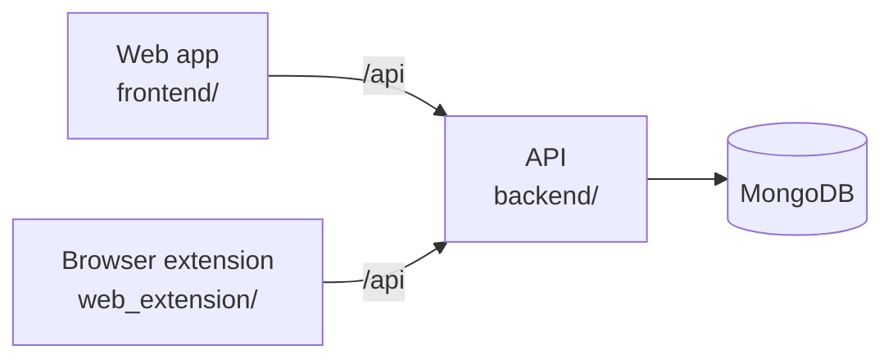

# PassDrop

A password manager for the web and the browser. Keep your logins in one vault, open them from a web app, and fill them into other sites from a browser extension.

- [Features](#features)
- [How it fits together](#how-it-fits-together)
- [Repository layout](#repository-layout)
- [Getting started](#getting-started)
- [Configuration](#configuration)
- [Scripts](#scripts)
- [Testing](#testing)
- [Local build or release build](#local-build-or-release-build)
- [Deployment](#deployment)
- [Security](#security)
- [Status and roadmap](#status-and-roadmap)

## Features

- **Vault**: add, search, edit and delete logins, and mark favourites. Everything in it is encrypted in your browser before it is saved, so the server only ever stores data it cannot read (see [Security](#security)).
- **Password generator**: adjustable length and character sets, with strength feedback as you type.
- **Lock and recovery**: the vault locks whenever its tab is closed (the extension locks when the browser is closed) and asks for your master password to open again. A recovery key, shown in a popup the first time you open the Account page after signing up, is for the day you forget the master password. If you did not save it, you can make a new one on the Account page at any time (the old one then stops working).
- **Account**: change your master password (with a strength meter) and a danger zone for deleting all logins or the account. Both ask for your master password again.
- **Browser extension** (Chrome, Edge, Brave and other Chromium browsers): click a login field on a site you have a login for, and a PassDrop menu offers it. Nothing is filled until you click a row.
- **Water-themed interface**: a tide animation between pages, and passwords revealed through a waterline that drains away.

## How it fits together



The web app and the extension are both clients of the same API, and sign in with the same account. In production the web app and the API share one address (see [Deployment](#deployment)), and the web app serves the extension download.

## Repository layout

It is one npm workspace: install once at the root, and there is a single lockfile.

```
frontend/          the web app (React + Vite + Tailwind)
backend/           the API (Express + MongoDB); backend/bruno holds an API request collection
web_extension/     the browser extension (Manifest V3)
api/index.js       entry point that runs the API as a Vercel function
vercel.json        how the one Vercel project is built and routed
.env.example       a reference for every setting, by file
```

Each part has its own README with the details: [`frontend/`](frontend/README.md), [`backend/`](backend/README.md), [`web_extension/`](web_extension/README.md).

## Getting started

Everything in this section points at `localhost`; nothing touches the live site.

**You need** Node.js 20.19 or newer (22 or 24 recommended) and a MongoDB database, such as a free Atlas cluster or a local one.

**1. Install**

```bash
npm install
```

**2. Configure.** Create these two files (the [full list of settings](#configuration) is below):

`backend/.env`

```env
MONGODB_URI=mongodb+srv://<user>:<password>@<cluster>/?retryWrites=true&w=majority
JWT_SECRET=<a long random string>
```

`frontend/.env`

```env
VITE_BACKEND=http://localhost:3000
```

Make the secret with this command:

```bash
node -e "console.log(require('crypto').randomBytes(32).toString('hex'))"
```

Use a fresh value for local work. Never reuse the production one. (There is no encryption key to set: logins are encrypted in the browser, so the server holds nothing that could decrypt them.)

**3. Run the API and the web app**

```bash
npm run dev
```

The API is at <http://localhost:3000> and the web app at <http://localhost:5173>. Open the web app and create an account.

**4. Run the extension (optional)**

Create `web_extension/.env`:

```env
VITE_BACKEND=http://localhost:3000
VITE_WEB_APP_URL=http://localhost:5173
```

Build it with the dev script:

```bash
npm run build:extension:dev
```

Then open `chrome://extensions`, turn on **Developer mode**, click **Load unpacked** and choose `web_extension/dist`. Rebuilding, reloading the extension and trying the test pages are covered in [`web_extension/README.md`](web_extension/README.md#try-it-locally).

> **Use `build:extension:dev`, not `build:extension`.** The plain build is a production build: it ignores `.env` and points the extension at the live site, so it cannot reach your local API.

## Configuration

Every setting, by file. A `.env` file is never committed. `.env.example` at the root repeats this table as a copyable reference.

| File | Setting | Required | What it does |
|---|---|---|---|
| `backend/.env` | `MONGODB_URI` | yes | MongoDB connection string. |
| | `JWT_SECRET` | yes | Signs sign-in tokens. Use 32 or more random characters (the API warns if shorter). |
| | `PORT` | no | API port. Default `3000`. |
| | `DB_NAME` | no | Database name. Default `PassDrop`. |
| | `JWT_EXPIRES_IN` | no | How long a sign-in lasts. Default `7d`. |
| `frontend/.env` | `VITE_BACKEND` | for local work | Address of the API. In production it is empty, because the API is on the web app's own address. See `frontend/.env.production`. |
| `web_extension/.env` | `VITE_BACKEND` | yes | Address of the API. The extension may only call this origin. |
| | `VITE_WEB_APP_URL` | yes | Address of the web app, for the extension's "Open PassDrop" link. |
| `web_extension/.env.production` | the same two | yes | The live site's addresses. Committed, and used by release builds only. |

The extension's addresses are fixed when it is built, because an extension has no runtime environment. That is why it has two files, and why the two builds below matter.

## Scripts

Run from the repository root.

| Command | What it does |
|---|---|
| `npm run dev` | API and web app together, with reload. |
| `npm run dev:backend`, `npm run dev:frontend` | One of the two on its own. |
| `npm run build:frontend` | Production build of the web app into `frontend/dist`. |
| `npm run build:extension:dev` | Extension build for local development, into `web_extension/dist`. |
| `npm run package:extension` | Release build of the extension, zipped as the web app's download. Vercel runs it on every deploy; run it yourself only to try the download page locally. See below. |
| `npm run build:extension` | A plain (production) extension build. Rarely what you want; see the note above. |
| `npm test` | All the automated tests: the web app, the API and the extension. |
| `npm run test:browser --workspace=web_extension` | The extension's real-Chrome test. Needs Chrome. |
| `npm run test:e2e` | The web app's real-browser end-to-end check: sign-up, recovery key, lock screen, password change, recovery, and a scan of the database for anything readable. Builds the web app first and needs Chrome. |
| `npm run lint --workspace=frontend` | ESLint on the web app. |

## Testing

```bash
npm test                                         # everything below, no browser needed (the API tests start a real MongoDB; see below)
npm run test:browser --workspace=web_extension   # real Chrome, needed for the extension menu's click checks
npm run test:e2e                                 # real Chrome, the whole web app against a throwaway database
```

`npm test` runs the tests of all three parts one after another and fails if any of them fails:

| Part | Tests | Tool | What they cover |
|---|---|---|---|
| Web app (`frontend/`) | 102 | Vitest and jsdom (a stand-in browser) | The encryption module (key derivation, wrapping, sealing, the recovery key), sign-up with the recovery key screen, sign-in, the lock screen, recovery, the Account page, the password mask, the site icons, the generator and the session-expiry handling |
| API (`backend/`) | 61 | Node's built-in runner and Supertest, against a real MongoDB started for the tests | Sign-up and sign-in, the 15-minute lockout, re-authentication, sessions dying after a password change, recovery, who can touch whose logins, and that no readable field is ever stored |
| Extension (`web_extension/`) | 97 | Node's built-in runner and jsdom | Address matching, field detection, signing in and unlocking in the service worker (with real encrypted data), the content script's rules and the popup helpers |

Each test is a small program that runs part of the code with known input and checks the answer. A good run prints a tick for each test and ends with a summary of passed and failed counts; a failure names the test and shows what it expected. To run one part, use `npm test --workspace=frontend` (or `backend`, `web_extension`).

The browser test (`npm run test:browser --workspace=web_extension`) drives real Chrome with real clicks against the built extension (set `CHROME_PATH` if Chrome is not in a usual place). `npm run test:e2e` does the same for the web app: it serves the built app and the API from one address, as in production, and checks the flows that make the vault zero-knowledge, ending with a scan of the whole database for the logins, master passwords and recovery key it used. The API tests start a real, throwaway MongoDB for each test file and never touch your real database. **The first run downloads MongoDB 7.0 once (about 590 MB on Windows)** into `~/.cache/mongodb-binaries`, shared by every project; after that it starts in a second or two. To fetch it ahead of time, run `node -e "require('mongodb-memory-server-core').MongoMemoryServer.create().then(s => s.stop())"` in `backend/`. Try the API by hand with the requests in [`backend/bruno`](backend/bruno/README.md).

## Local build or release build

The extension is the one part with two builds, which differ in which file its addresses come from.

| | Local development | Release |
|---|---|---|
| Command | `npm run build:extension:dev` | `npm run package:extension` |
| Addresses from | `web_extension/.env` (localhost) | `web_extension/.env.production` (the live site) |
| Output | `web_extension/dist/` | `web_extension/dist/` and `frontend/public/PassDrop.zip` |
| Used for | Loading unpacked in your own browser | The download on the web app's Extension page |

**The download zip is not committed.** `frontend/public/PassDrop.zip` is git-ignored and Vercel builds it on every deploy (see below), so it always matches the code and there is nothing to rebuild or commit. Run `npm run package:extension` yourself only if you want the Extension page's download link to work in local development. A release build overwrites `web_extension/dist/`, so run the dev build again afterwards to go back to local testing.

## Deployment

The web app and the API are deployed together as one **Vercel** project:

- `vercel.json` first builds and zips the extension (`npm run package:extension`, using `web_extension/.env.production`), then builds the web app (`npm run build:frontend`), and serves `frontend/dist`. The web app build copies the zip in, so the Extension page's download is always the extension from the same commit.
- Requests to `/api/*` go to `api/index.js`, which runs the Express app from `backend/` as a serverless function. Every other address serves the web app.
- The two backend settings (`MONGODB_URI`, `JWT_SECRET`) are set in the Vercel project's environment variables. They are not in the repository.

To deploy, import the repository in Vercel (the settings come from `vercel.json`), add the two variables, and deploy. If the site's address ever changes, update `web_extension/.env.production`; the next deploy builds the zip for the new address.

`vercel.json` also sets the security headers, including a Content-Security-Policy. The rate limit on the sign-in endpoint is a Firewall rule in the Vercel dashboard, not code.

## Security

- Master passwords are hashed with bcrypt. Ten wrong attempts in a row lock an account for 15 minutes. Changing the master password signs out every other session. Deleting the account, deleting all logins and changing the master password ask for the master password again.
- **The server cannot read your vault.** Your master password never leaves your browser. The browser stretches it (PBKDF2-SHA256, 600,000 rounds) into two keys: one is a sign-in proof the server stores only as a bcrypt hash, the other locks a random vault key. Every login (title, address, username, password, notes) is encrypted with that vault key (AES-256-GCM) in the browser before it is sent, and the server keeps the vault key only in locked form. The code is in [`frontend/src/lib/vaultCrypto.js`](frontend/src/lib/vaultCrypto.js).
- **Locking:** the vault key is kept only for as long as the tab is open (the extension: until the browser closes). Reopening needs the master password again, locally, without the server seeing it.
- **If you forget your master password, you need the recovery key** (shown once, the first time you open the Account page after signing up, and replaceable there at any time; 32 hex digits). **If you lose both, nobody can recover the vault, including whoever runs the server.** That is the point of the design.
- The extension puts a password into a web page only after a real click on a row in its menu, and only for the exact site (host and port) the login was saved for. See [`web_extension/README.md`](web_extension/README.md#what-a-web-page-can-and-cannot-do).

## Status and roadmap

Done: the vault is encrypted in the browser (zero-knowledge), with a recovery key. Planned, in this order:

1. **A freeze and thaw animation for the lock screen.**
2. **Drop sharing**: share one login by a link that expires, with the key kept in the link's fragment so the server never sees it.

Known limits of the extension today: it handles the top frame only (no login forms inside iframes) and no shadow-DOM forms.

## License

MIT. See [LICENSE](LICENSE).
